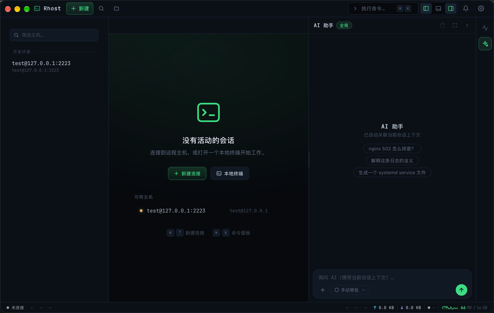
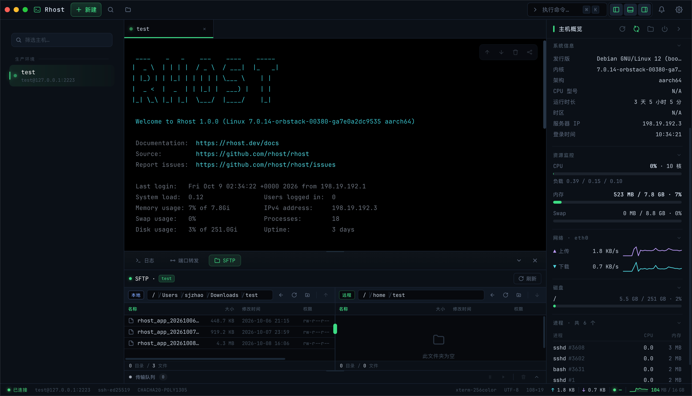
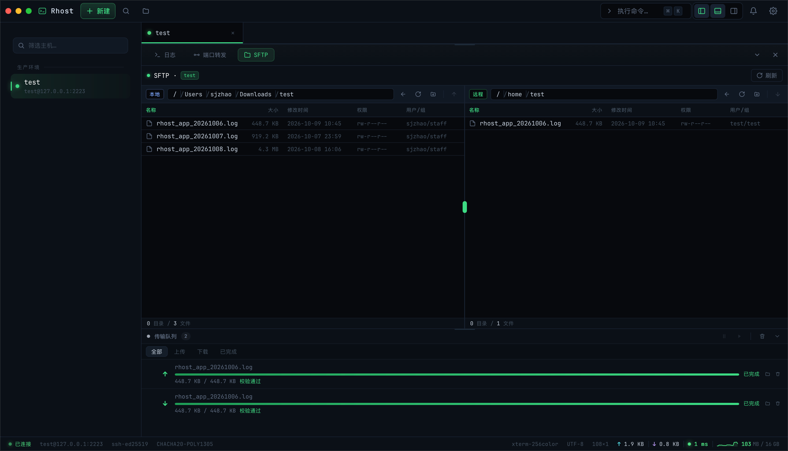
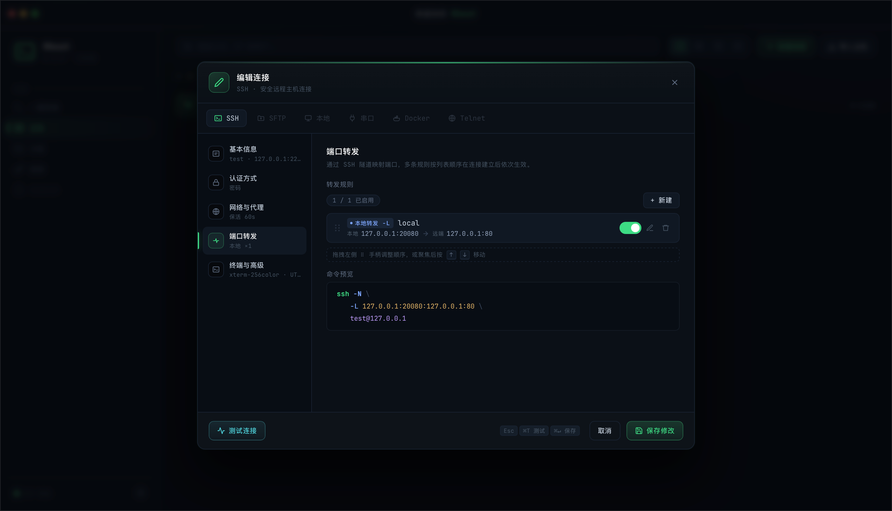
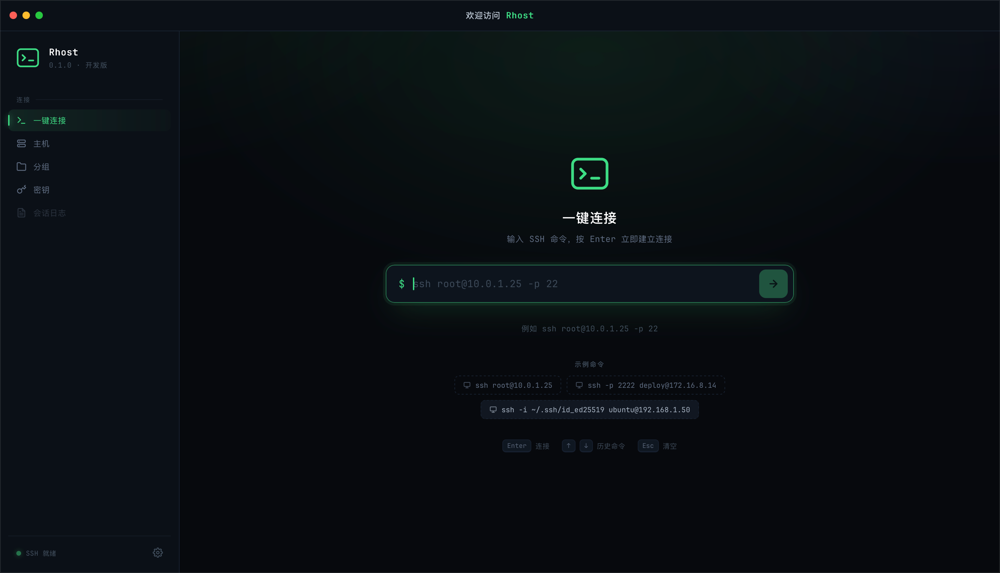

<div align="center">
  
</div>

<h1 align="center">Rhost</h1>

<p align="center">
  Cross-platform high-performance remote host manager (SSH terminal + SFTP + port forwarding + server monitoring + AI assistant)
</p>

<p align="center">
  <a href="LICENSE"></a>
  
  
  
  
</p>

<p align="center">
  <a href="./README.zh-CN.md">中文</a> · <strong>English</strong>
</p>

<p align="center">
  <a href="https://shijiecloud.github.io/rhost/" target="_blank">📖 Documentation</a> (currently in Chinese) · <a href="#-quick-start">Quick Start</a> · <a href="CHANGELOG.md">Changelog</a>
</p>

---

**Rhost** is an open-source desktop remote host manager built with Rust + Tauri 2.
It uses a **native binary IPC stream** architecture: high-frequency terminal byte streams travel over a custom binary-framed Channel instead of JSON, while low-frequency control messages use invoke/JSON. This avoids JSON serialization overhead and ANSI corruption under heavy terminal output, and sidesteps the high memory usage and multi-connection stutter typical of Electron-based terminal tools.

**An AI assistant has been built in since v2.0.0**: troubleshoot remote hosts, run commands and modify files through conversation — read-only tools explore without any approval, while write operations are decided in an approval dialog; complex tasks are drafted by the model (Plan-and-Act) and executed step by step after your confirmation, fully visible and interruptible.

## ✨ Features

- 🤖 **Built-in AI assistant**: streaming chat with reasoning visualization and Markdown / code rendering; code blocks can be inserted into the terminal or executed with one click; workbench sessions and the home-page global chat stay isolated per view
- 🧭 **Plan-and-Act task planning**: the model drafts a plan for complex tasks and executes it step by step after confirmation, with live per-step status; failed steps can be retried, skipped, aborted or re-planned, and a plan converges early once the goal is met or the remaining steps become infeasible
- 🛡️ **Tool authorization & risk control**: read-only tools run automatically without approval; command proposals, file edits and SFTP transfers are decided in an approval dialog (once / session-scoped allowance, plus three permission levels), with built-in high-risk command detection, automatic backup before edits and rejection of critical system paths
- 🧠 **Skills, rules & memory injection**: inject domain knowledge and behavioral constraints through local `.md` files, with cross-session memory extracted automatically; injection budget, per-file toggles and manual management stay controllable
- 🖼️ **Multimodal input**: attach images and text files by picker, paste or drag-and-drop
- 🖥️ **Multi-tab SSH terminal**: xterm.js rendering with end-to-end UTF-8 pass-through; every session owns a dedicated IPC Channel with fully isolated data streams
- ♻️ **Automatic reconnect**: disconnect causes are classified; unexpected network drops trigger exponential-backoff reconnection (doubling from 1s, capped at 30s), while manual disconnects and clean remote exits never reconnect
- 📁 **Built-in SFTP file manager**: dual-pane browsing, streaming transfer queue, resume, pause / cancel; shell and SFTP working directories stay in sync both ways
- 🔗 **SSH port forwarding**: local forwarding, remote forwarding and SOCKS5 dynamic proxy, with live status and traffic statistics
- 📈 **Server monitoring**: MOTD welcome panel plus periodic CPU / memory / disk / network / process / GPU metrics collected over a dedicated exec channel — zero sudo, nothing written on the remote host
- 🔐 **Host key verification**: TOFU (trust on first use) with persisted known_hosts fingerprints; key changes raise a red warning to guard against MITM
- 🔑 **Secure credential storage**: passwords and private-key passphrases go to the OS keychain (macOS Keychain / Windows Credential Manager / Linux libsecret); configurations are persisted as atomic local JSON writes and **never contain secrets**
- 📂 **Host & key management**: groups, notes, quick connect, connection status monitoring and key management
- 📤 **Config import / export**: bulk import and export of the full configuration or host lists, with a one-click restart to apply
- 📝 **Application logging**: startup / shutdown event sequence, persisted logs with expiry cleanup, and a log panel in the UI fed by live subscription
- ⚡ **High-performance async core**: a pure-async russh implementation with 4KB/5ms batching and bounded backpressure; the UI never blocks
- 🎨 **Native cross-platform desktop**: built on Tauri for a small footprint and low memory usage, running on macOS / Windows / Linux

## 📐 Architecture

- **Backend**: Rust (edition 2024) + fully async Tokio + russh + russh-sftp + keyring
  - All SSH IO is pure async; each session binds to its own IPC Channel, and session lifecycles are managed centrally in Rust
  - Terminal byte streams use custom binary frames (`type:u8 + len:u32 + payload`), while low-frequency control messages use invoke / JSON
  - Everything under `ssh/` except manager stays Tauri-independent and can be unit / e2e tested on its own; `ipc.rs` remains a thin layer (validation + forwarding only)
  - `ai.rs` wraps the OpenAI-compatible protocol on its own (JSON + SSE streaming + tool calls), with no third-party agent framework
- **Frontend**: Vue 3.5 (`<script setup>`) + TypeScript + Vite + Xterm.js
  - Raw binary streams arrive over IPC Channels and feed straight into xterm to render ANSI terminal sequences
  - Module-level singleton state management (no Pinia / Vue Router), split into components: host tree, terminal pane, SFTP pane, monitoring pane, AI chat panel and global settings

> Architectural highlight: **terminal data never goes through JSON serialization** — no serialization overhead on heavy output, no ANSI corruption.

## 📸 Screenshots

<p align="center">
  <br/>
  <sub>Built-in AI assistant: streaming chat, one-click code insertion into the terminal, reasoning visualization, plus skills / rules / memory injection</sub>
</p>

<p align="center">
  <br/>
  <sub>Plan-and-Act: step-by-step execution after confirming the draft plan, with live per-step status and retry / skip / abort / re-plan on failure</sub>
</p>

<p align="center">
  <br/>
  <sub>Workbench: multi-tab terminal + MOTD welcome panel + SFTP file manager + live server monitoring</sub>
</p>

<p align="center">
  <br/>
  <sub>Dual-pane SFTP file manager: streaming transfer queue, resume, pause / cancel and file verification</sub>
</p>

<p align="center">
  <br/>
  <sub>Visual port forwarding: local / remote / SOCKS5 rules with live SSH command preview</sub>
</p>

<p align="center">
  <br/>
  <sub>Quick connect: paste an SSH command to connect in one step, with built-in examples and history</sub>
</p>

## 🚀 Quick Start

### Prerequisites (macOS)

```bash
# Xcode command line tools
xcode-select --install
# System libraries
brew install libssh2 openssl@3 cmake pkg-config
# Install rustup
curl --proto '=https' --tlsv1.2 https://sh.rustup.rs -sSf | sh
source "$HOME/.cargo/env"
# Install the Tauri CLI
cargo install tauri-cli --version "^2.0.0" --locked
```

### Prerequisites (Windows)

- Install [rustup](https://rustup.rs/) (the `stable-msvc` toolchain is recommended) and [Node.js](https://nodejs.org/) (managing it with [nvm-windows](https://github.com/coreybutler/nvm-windows) is recommended)

### Prerequisites (Linux)

Tauri 2 uses `webkit2gtk-4.1` (no longer 4.0); package names differ slightly across distributions:

```bash
# Ubuntu / Debian
sudo apt update
sudo apt install -y libwebkit2gtk-4.1-dev libgtk-3-dev \
  libayatana-appindicator3-dev librsvg2-dev libssl-dev \
  cmake pkg-config build-essential

# Fedora
sudo dnf install -y webkit2gtk4.1-devel gtk3-devel \
  libayatana-appindicator3-devel librsvg2-devel openssl-devel \
  cmake pkgconf-pkg-config gcc-c++

# Arch Linux
sudo pacman -S --needed webkit2gtk-4.1 gtk3 \
  libayatana-appindicator librsvg libressl cmake pkgconf base-devel
```

> SSH connections are built on pure-Rust [russh](https://crates.io/crates/russh), so no system `libssh2` or `openssl` dynamic library is required; the Tauri CLI is already listed in the frontend `devDependencies`, so no global install is needed.

### Clone & run in development

```bash
git clone https://github.com/ShiJieCloud/rhost.git
cd rhost

# Install frontend dependencies
cd frontend
npm install
cd ..

# Start the development build
cargo tauri dev
```

### Build production installers

```bash
cargo tauri build
```

## 📂 Project Layout

```
rhost/
├── .github/
│   └── workflows/                # CI pipelines
│       ├── release.yml            #   Three-platform packaging and release
│       └── docs.yml               #   Docs site build and deployment
├── docs/                          # VitePress documentation site
├── docker/
│   └── debian-sshd/               # Full-feature MOTD test container (port 2223)
├── frontend/                      # Vue 3 frontend
│   ├── src/
│   │   ├── main.ts                #   Entry point (no router / state library)
│   │   ├── App.vue                #   Root component: home / workbench switching + global modals
│   │   ├── views/                 #   Top-level views: HomeView, Workbench
│   │   ├── components/            #   Shared components (AI chat panel AiChatPanel / AiMarkdown / RightPanel, etc.); wb/ holds workbench components
│   │   ├── stores/                #   Module-level singletons (session/hosts/settings/groups/keys/tunnels/applog/aiQuote, etc.)
│   │   ├── composables/           #   useToast / usePasswordPrompt / useHostKeyPrompt
│   │   ├── lib/                   #   tauri (isTauri detection), ai (streaming chat + tool calls), aiRisk (high-risk detection), markdown
│   │   └── types.ts               #   Types shared across modules
│   ├── vite.config.ts             #   Fixed port 5173
│   └── package.json
├── src-tauri/                     # Rust backend
│   ├── capabilities/              #   Tauri permission allowlist
│   ├── icons/                     #   App icons (macOS / Windows / Linux / iOS / Android)
│   ├── tests/
│   │   └── ssh_e2e.rs             #   End-to-end tests requiring a local Docker sshd
│   ├── src/
│   │   ├── main.rs / lib.rs       #   Startup entry; plugin and command registration, State injection
│   │   ├── ipc.rs                 #   IPC adapter layer (thin): validation + forwarding
│   │   ├── ssh/                   #   SSH connections, PTY, SFTP, keepalive, tunnels
│   │   │   ├── frame.rs            #     Binary frame encoding / decoding
│   │   │   ├── session.rs          #     russh connect / auth / PTY IO / batching / reconnect
│   │   │   ├── manager.rs         #     Session pool lifecycle management
│   │   │   ├── sftp.rs             #     SFTP subchannel, streaming transfers, cancel / pause
│   │   │   └── tunnel/             #     Port forwarding and SOCKS5
│   │   ├── metrics/               #   Remote metric parsing and periodic collection
│   │   ├── motd/                   #   MOTD structured directive generation
│   │   ├── ai.rs                   #   AI assistant (OpenAI-compatible SSE chat, tool calls, skills / rules / memory injection)
│   │   ├── applog/                 #   Application logging (hub / logger / writer / persisted)
│   │   ├── store.rs                #   connections.json + OS keychain
│   │   ├── localfs.rs              #   Local filesystem operations
│   │   ├── known_hosts.rs          #   Host key fingerprint persistence
│   │   ├── config_io.rs           #   Configuration read / write
│   │   ├── config_crypto.rs       #   Configuration encryption
│   │   ├── config_migrate.rs      #   Configuration migration
│   │   ├── fonts.rs                #   System font detection
│   │   └── sysmon.rs               #   Local memory sampling
│   ├── tauri.conf.json            #   Window, devUrl, build hooks
│   ├── build.rs
│   └── Cargo.toml
├── package.json                   # Docs site and commit tooling scripts
├── pnpm-workspace.yaml
├── CHANGELOG.md                   # Manually maintained release notes (Keep a Changelog format)
├── LICENSE
├── README.md                      # English (default on GitHub)
└── README.zh-CN.md                # Chinese
```

## 🤝 Contributing

> The project is still in early development; issues discussing requirements and bugs are welcome.

1. Fork this repository
2. Create a feature branch: `git checkout -b feature/xxx`
3. Commit your changes: `git commit -m 'feat: add xxx'`
4. Push the branch: `git push origin feature/xxx`
5. Open a pull request

### Commit convention

This project follows [Conventional Commits](https://www.conventionalcommits.org/en/v1.0.0/), with commit messages formatted as `type[(scope)]: description`:

- `feat` feature / `fix` bug fix / `docs` documentation / `refactor` refactoring / `perf` performance / `test` tests / `chore` maintenance / `style` formatting
- Keep the description concise, in English or Chinese, e.g. `feat(tunnel): 支持实时流量统计`, `fix(ssh): 修复断线端口泄漏`

The repository ships with `commitlint` + `husky` hooks that validate `commit-msg` on every `git commit` and reject non-conforming messages. At release time the maintainer summarizes the commit history into `CHANGELOG.md` (Keep a Changelog format), and the pipeline assembles the Release body from that section.

## ⚠️ Notes

- This is an open-source learning project and comes with **no warranty**; evaluate the risks yourself before using it in production.
- Server passwords are never stored in plain text in local configuration files — they are kept in the OS keychain.
- Private key file paths are only recorded locally and are never uploaded or synced to any third-party server.
- The AI assistant never reads terminal content automatically: only terminal content you explicitly select and send, plus the contents of skills / rules / memory files, are sent to your configured model provider along with the conversation. AI module settings (including API keys) are excluded from configuration import / export.

## 📄 License

[MIT](LICENSE) © Rhost Contributors
