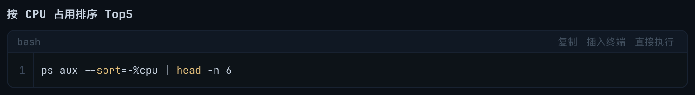
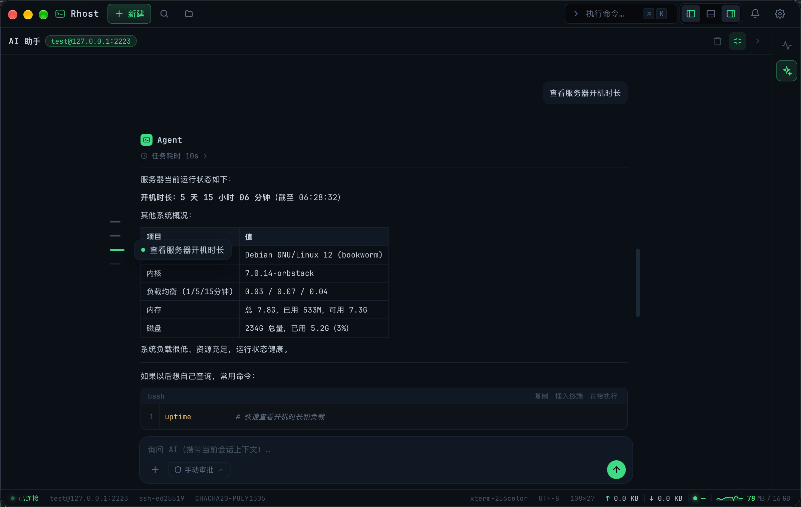

# AI 助手使用指南

> description: AI 助手的入口、对话交互、消息操作、推理可视化、附件采集、会话大纲与历史会话使用说明
>
> created: 2026-10-15 11:27:07
>
> updated: 2026-10-15 14:31:00
>
> author: [sjzhao](https://github.com/ShiJieCloud/rhost)

## 1. 前置条件

AI 助手默认开启，但需先在「设置 → AI 助手 → 连接与凭据」中配置服务商、接口地址（Base URL）与模型，否则输入区置灰。

| 设置项 | 说明 |
|---|---|
| 服务商 | `custom` / `openai` / `deepseek` / `ollama`，选择后自动填充兼容 API 地址，仍可手动修改 |
| 接口地址 Base URL | OpenAI 兼容接口地址 |
| API 密钥 | 加密存储于系统钥匙串；设置为空表示不修改，Ollama 本地服务可留空 |
| 模型 | 建议使用中等规模模型，命令生成延迟更低 |
| 测试连接 | 使用面板草稿值请求模型列表，验证地址与密钥可用 |

关闭「启用 AI 助手」后右侧栏隐藏 AI 入口，快捷键随之停用。完整设置项见 [全局设置](../reference/global-settings.md) §9。

## 2. 入口与面板

AI 助手位于右侧面板，有以下入口：

- **右侧图标栏**：点「AI 助手」图标（星形图标）展开并切到 AI 页签；页签激活时再点一次即折叠面板；
- **快捷键**：`Ctrl/⌘+I` 折叠或展开面板并切到 AI 页签；
- **终端引用**：工作台终端右键 → 「添加到 AI 对话」，选中文本作为引用块填入输入区，并自动切到 AI 面板。

面板头部标题固定为「AI 助手」，标题后附带 scope 标识：

| 场景 | scope 标识 |
|---|---|
| 首页对话 | 全局 |
| 工作台当前会话 | 当前主机名（优先显示别名，回落主机 ID） |

对话按 scope **完全隔离**：首页为全局通用对话，工作台为绑定当前主机的独立对话，切换视图自动切换对应记录，不跨 scope 携带上下文。

面板头部右侧提供「清空对话」与专注模式（面板占满主区）按钮，专注模式下 AI 面板内容限宽 760px 居中；拖拽把手双击可快速进出专注模式。

窗口宽度 ≤1180px 时右侧图标栏与面板自动隐藏（响应式断点，与监控面板一致）。

> AI 对话 scope 与主机绑定，因此「插入终端 / 直接执行」（见 [AI 终端执行与授权](./ai-terminal-exec.md)）与规划模式仅在**工作台**可用。

## 3. 对话与输入区

输入区为多行输入框（1~6 行内自增高，超出内部滚动），底部工具行包含以下元素：

| 元素 | 说明 |
|---|---|
| `+` 按钮 | 下拉菜单：上传附件、规划模式（见 [规划模式](./ai-plan-mode.md)） |
| 权限档下拉 | 手动审批 / 低危自动 / 完全访问，详见 [AI 终端执行与授权](./ai-terminal-exec.md) §4 |
| 发送按钮 | 绿色圆形上箭头；任务运行期间变为方形停止按钮，点击中止本轮 |
| 任务耗时 | 任务运行期间在输入区右侧显示 `hh:mm:ss` 计时，落定后改为固定值 |

键盘：`Enter` 发送、`Shift+Enter` 换行；中文输入法组合输入期间回车不误发。

发送条件放宽为「文本非空**或**附件非空」，纯附件消息也可发送。

## 4. 附件（图片与文本文件）

通过以下三种方式添加附件，三入口产出同构附件，共用同一条校验链路：

| 入口 | 操作 |
|---|---|
| 选择文件 | 点击输入区 `+` → 「上传附件」，从文件选择器选取 |
| 粘贴 | 在输入区直接粘贴剪贴板中的截图/图片 |
| 拖拽 | 从文件管理器把图片或白名单文本文件拖入输入区，拖动期间输入区高亮 |

附件以 chip 形式展示在输入框上方（图片为 22×22 缩略图，文本文件为文件图标 + 文件名），可逐个移除；发送成功后清空。

### 4.1 图片限制

| 约束 | 取值 |
|---|---|
| 格式白名单 | `image/png`、`image/jpeg`、`image/webp`、`image/gif` |
| 原始文件上限 | 8MB（超出即拒绝，不入内存） |
| 长边上限 | 1568px（超出按比例缩放；JPEG 以质量 0.85 重编码，PNG/WebP 保持原格式，GIF 取首帧转 PNG） |
| 压缩后上限 | 2MB |
| 单条消息张数 | 4 张（含图片合计体积 ≤ 6MB） |

未缩放的图片直接复用原始数据，避免无谓重编码损失。超限分别提示「不支持的图片格式」「图片过大，请压缩后重试」等。

### 4.2 文本 / 代码文件限制

| 约束 | 取值 |
|---|---|
| 扩展名白名单 | `.txt` `.md` `.log` `.csv` `.json` `.yaml` `.toml` `.ini` `.env` `.py` `.js` `.ts` `.vue` `.rs` `.go` `.java` `.sh` `.sql` 等（完整清单以代码为准） |
| 无扩展名白名单 | `dockerfile` / `makefile` / `rakefile` / `gemfile` / `procfile` / `brewfile` |
| 单文件上限 | 1MB |
| 单条消息个数 | 4 个 |
| 二进制守卫 | 内容前 8192 字符内出现 NUL 字节即判为二进制并拒绝（防改扩展名绕过白名单） |

白名单外的类型（如 `.pdf` / `.zip`）与疑似二进制文件均被拒绝。

### 4.3 发送与回显

- 文本/代码文件内容内联为 `<file name="…">…</file>` 块并入提问文本；
- 含图片的消息以 content parts 形式发送（文本在前、图片在后）；
- 附件随消息落盘，历史消息中回显缩略图与文件 chip；
- 图片与文本文件内容**不参与**摘要与记忆提取，避免无谓上传与体积膨胀。

> 附件内容与用户主动发送的文本同口径，会随对话发送给模型服务商；终端内容仍仅以用户显式选中发送为唯一入口。

## 5. 消息操作

**整个会话处于流式输出期间，所有消息操作按钮隐藏**（避免与进行中的流产生竞态）。会话空闲时，hover 消息即淡入操作栏：

| 消息 | 按钮 | 行为 |
|---|---|---|
| 助手消息 | 复制全文 | 复制原始 Markdown（含代码块围栏原文） |
| 助手消息 | 重新生成 | 定位最后一条用户消息并截断重发；`done` / `stopped` / `error` 三种状态均可用 |
| 用户消息 | 编辑重发 | 把该条内容填回输入框并聚焦，**实际发送时**才截断该条及其后全部消息 |
| 用户消息 | 复制 | 复制用户消息原文 |
| 用户消息 | 删除 | 删除该条用户消息及紧随其后的助手回复，**不弹二次确认** |

截断类操作（编辑重发 / 重新生成 / 删除）会同步校正滚动摘要：若摘要覆盖点落在被截断范围内，摘要清空并回退为全文携带，避免上下文引用已被删除的内容。

## 6. 推理可视化

助手消息的执行过程折叠区按轮次组织，每轮的思考过程可独立折叠：

- 思考阶段自动展开并显示「思考中…」脉冲动画，正文到达后自动收起；
- 用户手动点击切换展开/收起后进入**手动模式**，不再受自动逻辑覆盖；
- 推理内容使用 Markdown 渲染，支持代码块、列表等格式。

## 7. 代码块操作

助手回复中的代码块带行号显示，行号区域不可选中（复制时不会带入剪贴板），横向滚动时行号固定。代码块头部按钮：

| 按钮 | 说明 |
|---|---|
| 复制 | 复制该代码块原文（不含行号） |
| 插入终端 | 把该代码块写入当前活动会话 PTY，**不回车**，用户可先编辑 |
| 直接执行 | 把该代码块写入 PTY 并回车执行 |

「插入终端 / 直接执行」仅在工作台、存在在线会话且非流式输出期间可见，完整规则（多行限制、确认档位、高危检测）见 [AI 终端执行与授权](./ai-terminal-exec.md)。

## 8. 会话大纲

长对话时，消息区左侧 margin 会出现刻度导轨，用于快速定位历史提问：

- 显示门槛：对话轮数 > 3（用户消息 ≥ 4 条）**且**面板宽度 ≥ 828px，否则恒隐藏，无手动开关；
- 每条用户消息对应一个刻度，hover 显示悬浮标签（组执行状态点 + 标题，标题截断至 60 字符）；
- 点击刻度平滑滚动到对应消息，目标消息闪烁一次反馈；
- 滚动消息区时当前刻度高亮（scroll-spy），已读刻度颜色加深；导轨最多显示 10 个刻度，超出内部滚动，两端渐隐提示。

标题由用户消息本地派生（剔除附件块 → 折叠空白 → 截断至 60 字符），不发起模型调用；无文本内容时依次回退为「图片」、首个文件名、「（空消息）」。

## 9. 历史会话面板

首页右侧面板（图标栏时钟图标）展示「历史会话」——最近成功连接过的主机（含已关闭的会话），用于快速创建连接：

- 记录内容为连接时的快照：主机名称、IP、端口、用户名，显示名优先取主机全名；
- 点击记录直接使用主机 ID 读取最新配置发起连接，支持全部认证方式，与主机列表连接流程一致；
- 若主机已被删除，点击仅提示「主机已删除」，**不自动移除该条历史记录**；
- 展示条数由「设置 → 外观/界面 → 历史会话数量」控制（取值范围 5~100，默认 20），超出后丢弃最旧记录。

## 10. 相关设置

| 设置项 | 位置 | 说明 |
|---|---|---|
| 启用 AI 助手 | AI 助手 → 功能 | 关闭后隐藏右侧栏 AI 入口与快捷键 |
| 历史会话数量 | 界面 | 首页历史会话展示条数（5~100，默认 20） |
| 技能 / 规则 / 记忆 | AI 助手 | 见 [AI 技能、规则与记忆配置](./ai-skills-rules-memory.md) |
| 终端执行相关 | AI 助手 → 终端执行 | 见 [AI 终端执行与授权](./ai-terminal-exec.md) |

## 11. 下一步

- [AI 规划模式](./ai-plan-mode.md)：复杂任务的计划生成与分步执行；
- [AI 终端执行与授权](./ai-terminal-exec.md)：命令写入、授权弹窗与权限档；
- [AI 技能、规则与记忆配置](./ai-skills-rules-memory.md)：注入上下文的自定义知识与记忆；
- [全局设置](../reference/global-settings.md)：AI 模块全部设置项；
- [SFTP 文件传输](./sftp.md)：文件传输面板（AI 亦可发起传输，见终端执行指南）。
