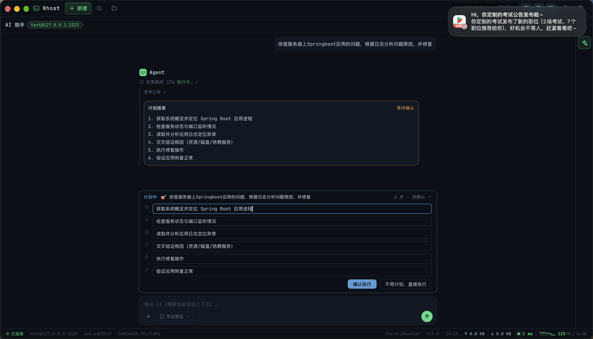
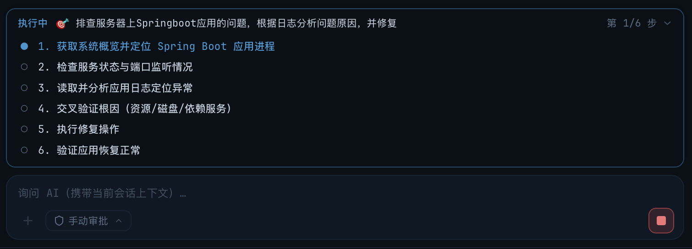
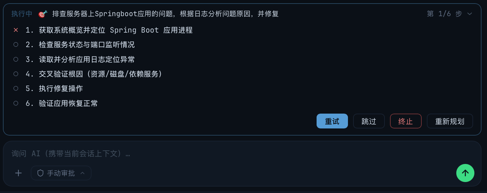
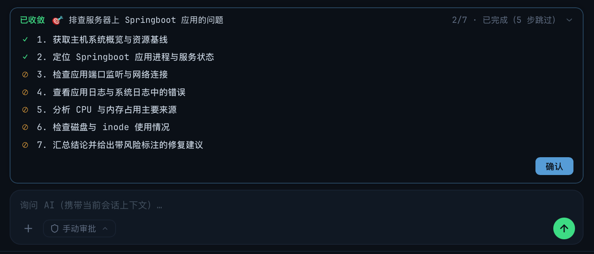

# AI 规划模式（Plan-and-Act）使用指南

> description: 规划模式的入口、计划草稿确认与编辑、分步执行、失败处理、提前收敛与变更文件面板的操作说明
>
> created: 2026-10-15 11:27:07
>
> updated: 2026-10-15 15:30:00
>
> author: [sjzhao](https://github.com/ShiJieCloud/rhost)

## 1. 适用场景与前置条件

规划模式把「先想清楚再动手」显式交给用户：模型先给出 3~8 步计划，用户确认后才逐步执行。适合跨多个服务的排障、需要多步验证的变更、涉及多个文件的重构等复杂任务。

**多数情况下无需手动开启**：模型会在对话轮内自主判定复杂度，复杂任务自动提案计划（工具 `propose_plan`），简单任务直接走普通对话 + 工具执行。

前置条件：仅**工作台** scope 可用（全局对话无终端可执行计划，输入区 `+` 菜单的「规划模式」项置灰）。见 [AI 助手使用指南](./ai-assistant.md) §2。

## 2. 两种触发方式

| 方式 | 操作 | 说明 |
|---|---|---|
| 菜单入口 | 输入区 `+` → 「规划模式」 | 输入框自动补 `/plan ` 前缀并聚焦，光标置末尾；菜单项在已带前缀时显示激活态（蓝色 + ✓） |
| 斜杠命令 | 在输入框手写 `/plan ` 开头 | 前缀后**必须有空格与目标文本**，单独 `/plan` 会被空内容守卫拦下不发送 |

两者完全等价（最终都表现为输入框带 `/plan ` 前缀）。命中前缀后前缀被剥离，剥离后的文本作为计划目标发送，**本轮强制只下发 `propose_plan` 工具**，由服务端 `tool_choice` 约束保证必然产出计划——不依赖模型是否愿意。

发送后输入区自动复位（前缀不残留）。若服务商不支持强制工具调用，会提示「未能生成计划，请重试或用普通方式描述任务」，原输入保留可重发。

> 触发强制规划时会记录埋点 `ai.plan.forced`（`via` = `menu` / `prefix` / `replan`）。

## 3. 计划草稿

模型产出的计划以**规划面板**呈现（面板位置见 §4），初始状态为草稿（徽标「计划中」、进度「N 步 · 待确认」）：

- **步骤文本可编辑**：草稿态每步的标题是可编辑输入框（上限 50 字符），确认时以输入框当前值生成快照；
- **步骤数**：3~8 步（后端与工具 Schema 双重校验，不足或超出的计划作废）；
- 草稿态只有两个按钮：

| 按钮 | 行为 |
|---|---|
| 确认执行 | 冻结当前（编辑后）步骤为快照并落盘，计划转 `executing`，从第 1 步开始执行 |
| 不用计划，直接执行 | 计划转 `cancelled` 并直接消失，本回合禁止模型再次提案计划，模型改为直接执行任务（用户输入不丢失） |

草稿未确认期间发送新消息会被拦截，必须先确认或拒绝。

> 埋点：`ai.plan.confirmed`（含 `step_count` 与建卡到点击的 `latency_ms`）、`ai.plan.refused`。

## 4. 活动规划面板

面板固定渲染在**输入框上方**（文档流布局，不遮挡上方消息），授权弹窗出现时临时让位隐藏，裁决完自动恢复。始终只有一个活动计划。

结构：面板头（徽标 + 标题行 + 进度 + 折叠箭头）→ 步骤列表 → 操作按钮行。整行可点击折叠/展开，新计划出现时自动展开。

### 4.1 徽标与进度

| 计划状态 | 徽标 | 进度文本 | 是否脉冲 |
|---|---|---|---|
| `draft` 草稿 | 计划中 | `N 步 · 待确认` | 否 |
| `executing` 执行中 | 执行中 | `第 X/N 步` | 是 |
| `done` 正常完成 | 已完成 | `N/N · 已完成` | 否 |
| `done` 提前收敛 | 已收敛 | `done/N · 已完成（K 步跳过）` | 否 |
| `cancelled` 已取消 | 已取消 | 已取消 | 否 |

### 4.2 标题行

- 展开态或草稿态显示计划目标（`🎯 目标`）；
- 折叠且执行中时显示**当前正在执行的步骤标题**（随步骤推进更新），配右侧进度文本，折叠时也能一眼看到进度。

### 4.3 步骤状态图标

| 状态 | 图标 | 含义 |
|---|---|---|
| `pending` | ○ 灰 | 待执行 |
| `running` | 蓝色脉冲圆点 | 正在执行（复用「思考中…」脉冲动画） |
| `done` | ✓ 绿 | 已完成 |
| `failed` | ✗ 红 | 失败 |
| `skipped` | ⊘ 黄 | 已跳过（用户跳过，或提前收敛后剩余步骤） |

步骤行只展示标题（一句话 todo）；每步的详细结果在执行过程折叠区的流式输出中可见，不在步骤行重复拼装。

## 5. 执行过程

- 每步独立跑一轮 ReAct 循环，工具轮次上限 6 轮（与普通对话一致，步间计数互不影响）；
- 每步执行时会注入计划上下文（目标 + 各步标题 + 当前步详情 + 已完成步骤摘要），预算 2KB，超出时丢弃最旧的已完成步骤摘要；
- 期间工具提案卡片、推理可视化、授权弹窗、消息操作按钮全部照常工作——写操作仍受权限档与授权约束，见 [AI 终端执行与授权](./ai-terminal-exec.md)；
- 执行期间想中断，点消息区既有的**停止生成**按钮：当前步转 `failed`（原因「用户中止」），计划保持执行中等待决策，**不回滚已执行的命令与文件修改**。

## 6. 失败处理

失败触发路径：模型回复 `error`、用户中止、该步工具轮次超上限（提示后转 failed）。

存在 `failed` 步时，按钮行给出四个操作：

| 按钮 | 行为 |
|---|---|
| 重试 | 该步重置为 `pending`、清空结果，重新执行；**不清除该步已产生的消息**（历史留痕，新起一条） |
| 跳过 | 该步转 `skipped`（结果记「用户跳过」），继续下一步（已是最后一步则进入总结） |
| 终止 | 计划转 `cancelled`，剩余步骤保持 `pending`，不再执行 |
| 重新规划 | 以「各步进展 + 失败原因」为输入强制重规划，产出的新计划**替换剩余步骤**并回到草稿态，再次确认后才执行 |

重新规划次数无硬上限（每次都由用户显式触发，天然限速）。

## 7. 提前收敛

当某步执行中发现「目标已达成可直接给答案」或「后续步骤因前提不成立不可行」时，模型可调用 `conclude_plan` 提前结束计划。**禁止**仅因困难或耗时收敛。

收敛后：

- 剩余未执行的步骤统一标记为 `skipped`，并按收敛原因显示对应跳过文案；
- 计划徽标变为「已收敛」、进度显示 `done/N · 已完成（K 步跳过）`；
- 面板**保留**展示各步最终状态（✓/⊘/✗）与一个「确认」按钮，用户点确认后面板才消失（普通 `done` 无按钮、自动消失）；
- 收敛提案在消息流中以卡片展示，标签为「提前收敛」或「任务阻塞」（取决于 `outcome` 为 `resolved` / `blocked`）。

## 8. 收尾与变更文件面板

全部步骤落定后自动进入**总结轮**：注入各步摘要、禁用工具调用，生成纯文本总结作为最终回答（首 token 即流入结果区）。

若本次计划执行产生了文件变更，计划面板消失后由**变更文件列表面板**接替，展示：

- 每个变更文件一行：左侧文件名，右侧 `+n`（新增行）/ `-n`（删除行）；
- 统计范围包含 `edit_file` / `write_file` 工具的文件变更，以及通过 shell 命令（heredoc、重定向、`tee`、`sed -i` 等）创建/修改的文件；无法确定行数的按 0 计；
- 面板可折叠，用户确认后消失。

## 9. 中断与状态收敛

| 场景 | 计划收敛行为 |
|---|---|
| 切换 scope 或清空对话 | 执行中计划转 `cancelled`，`running` 步转 `failed` |
| 应用崩溃后重启 | `running` 步转「应用中断」失败，计划面板恢复展示 |
| 删除 / 编辑重发 / 重新生成触发消息截断 | 对应计划一并作废（转 `cancelled`） |
| 会话断开 | 当前步骤直接失败，避免空转 |

计划状态随会话落盘，重启后可恢复展示。

## 10. 与普通对话的关系

- 计划只改变「工具集与执行编排」，不影响对话与授权链路；
- 若模型在同一轮同时提案计划与写操作，判定让位于实际动作：计划作废，模型直接执行（避免先规划被同时发生的执行覆盖）；
- 简单任务模型不提案计划，即退化为普通 ReAct 流程；用户也可随时用强制入口覆盖模型判定。

## 11. 相关文档

- [AI 助手使用指南](./ai-assistant.md)：入口、面板、消息操作与附件；
- [AI 终端执行与授权](./ai-terminal-exec.md)：每步执行的命令写入、授权弹窗与权限档；
- [ai-plan-and-act-design.md](../explanation/design/ai-plan-and-act-design.md)：状态机、上下文注入与视觉规范的设计依据；
- [ai-plan-early-convergence-design.md](../explanation/design/ai-plan-early-convergence-design.md)：提前收敛的判定与展示设计。
