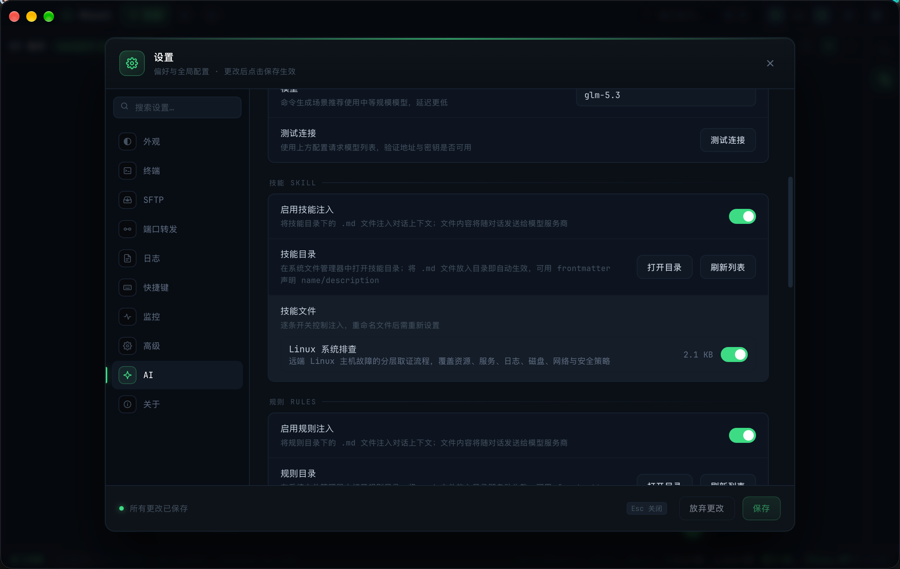
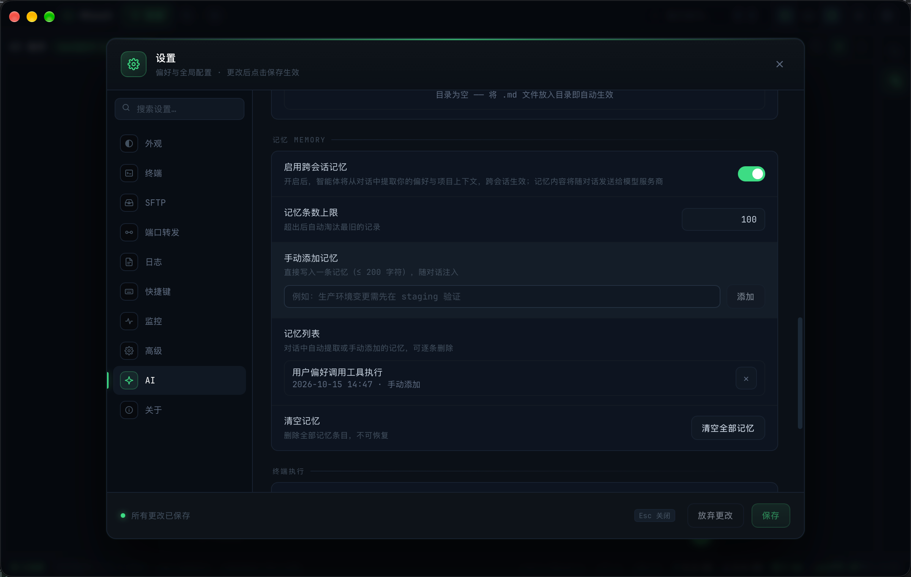

# AI 技能、规则与记忆配置

> description: 通过技能与规则文件注入自定义知识与约束、跨会话记忆的管理与提取规则，以及注入顺序与预算控制
>
> created: 2026-10-15 11:27:07
>
> updated: 2026-10-15 15:30:00
>
> author: [sjzhao](https://github.com/ShiJieCloud/rhost)

## 1. 三者定位

| 能力 | 载体 | 作用 |
|---|---|---|
| 技能 | `ai/skills/` 下的 `.md` 文件 | 提供领域知识与操作步骤（如「nginx 排障」「postgres 备份」） |
| 规则 | `ai/rules/` 下的 `.md` 文件 | 施加行为约束与偏好（如「禁止在测试机上执行 DDL」） |
| 记忆 | 应用内存 + 落盘条目 | 记录跨会话有效的偏好与事实，自动提取 + 手动维护 |

技能与规则来自磁盘文件（用户完全掌控），记忆由模型在对话后自动提取并允许手动增删。

## 2. 技能 / 规则文件

### 2.1 目录约定

| 项 | 取值 |
|---|---|
| 技能目录 | `app_config_dir/ai/skills/` |
| 规则目录 | `app_config_dir/ai/rules/` |

- 首次扫描或点「打开目录」时自动创建，无需手工建目录；
- 仅扫描**顶层 `.md` 文件**（扩展名小写比较）；
- 跳过隐藏文件（`.` 开头）、子目录、符号链接（避免逃逸出配置目录读入意外内容）；
- 按**文件名字典序**排序，保证注入顺序稳定。

### 2.2 文件格式

纯 Markdown，可选 `YAML frontmatter`（仅解析 `name` / `description` 两个键，极简 `key: value` 形式）：

```markdown
---
name: nginx 排障
description: Nginx 502/504 排查步骤与常用命令
---

# Nginx 502/504 排障

1. 检查后端服务是否存活：`systemctl status php-fpm`
2. 查看 nginx 错误日志尾部：`tail -50 /var/log/nginx/error.log`
3. 确认 upstream 超时配置：`proxy_read_timeout`
```

文件正文即为注入内容。**文件名（含扩展名）是开关与列表的稳定标识**——重命名文件会使旧的开关状态失效。

### 2.3 管理与生效

设置 → AI 助手 → 技能 / 规则分组提供：

- **总开关**（`aiSkillsEnabled` / `aiRulesEnabled`，默认开启）；
- **文件列表**：每项显示名称、描述、体积与逐条开关（关闭项写入 `aiSkillsDisabled` / `aiRulesDisabled` 文件名名单，默认空即全部启用），可预览正文；
- **打开目录**：用系统文件管理器打开对应目录，直接编辑文件。



技能与规则**每轮对话实时读取、不做缓存**，因此修改文件后下一轮对话即生效，无需重启应用。

### 2.4 预算与截断

| 约束 | 取值 |
|---|---|
| 单文件注入 | ≤ 8KB（超出只读前 8KB，标记为已截断） |
| 每类合计注入 | ≤ 16KB |

单文件读取失败（权限/编码）跳过该文件，不影响其余文件；目录不存在或创建失败返回空，不中断对话。

## 3. 记忆

### 3.1 设置项

| 设置项 | 默认值 | 说明 |
|---|---|---|
| 启用跨会话记忆 | 开启 | 关闭后不注入、不提取 |
| 记忆条数上限 | 100（10~1000） | 超出后淘汰最旧记录 |

记忆分组还提供：记忆列表（内容 / 创建时间 / 来源 / 逐条删除）、手动添加、清空。



### 3.2 自动提取

对话完成后**后台异步**提取（不阻塞对话主流程）：

- 触发条件：本轮未提取的新增内容 ≥ **4000 字符**（约 2k tokens），一轮对话最多触发 1 次；
- 提取由模型完成，输出 JSON 数组，每条为简洁中文陈述句；
- **不提取**一次性问题、闲聊、已解决的临时故障；
- **不记录**密码、私钥、API Key、Token 等敏感凭据；
- 单条内容 ≤ 200 字符（保存时截断）。

### 3.3 注入与预算

记忆**全局注入**（`sourceScope` 仅用于设置界面展示来源，不影响注入范围）。

| 约束 | 取值 |
|---|---|
| 单条记忆 | ≤ 200 字符 |
| 注入合计 | ≤ 8KB（UTF-8 字节） |

超限时从**最旧**开始丢弃，并在末尾追加「（其余 N 条记忆因总量超限未注入）」。存储按创建时间升序，淘汰从最旧开始。

## 4. 注入顺序与总预算

每轮对话装配为 system 消息，顺序固定：

```text
规则 → 技能 → 记忆 → 滚动摘要 → 会话上下文
```

技能与规则合计 16KB 预算（超出的靠后文件被丢弃并标注）；记忆独立 8KB 预算；规划模式的计划上下文另用 2KB 独立预算，互不挤占。

## 5. 隐私提示

技能、规则与记忆的内容会**随对话一并发送给模型服务商**，与用户显式发送的文本同口径。因此：

- 不要在技能/规则文件中写入凭据、内网敏感信息；
- 记忆提取指令已明确禁止记录凭据，但仍建议定期检查记忆列表。

另外，设置面板中 AI 模块的设置参数**不参与**应用配置导入导出，避免密钥随配置文件外流。

## 6. 常见问题

**注入后 AI 未遵循技能内容？**

1. 确认总开关已开、该文件逐条开关为启用；
2. 检查文件是否超过 8KB 被截断（正文后半段不会注入）；
3. 检查文件是否为顶层 `.md`（子目录、隐藏文件、符号链接均被跳过）；
4. 同类文件过多导致 16KB 预算耗尽时，靠后文件被丢弃——精简或合并内容，或拆分给更贴近任务的文件。

**记忆没有自动积累？**

- 确认「启用跨会话记忆」已开；
- 触发需要本轮新增内容 ≥ 4000 字符，短对话不会触发；
- 也可在记忆分组手动添加。

## 7. 相关文档

- [AI 助手使用指南](./ai-assistant.md)：面板入口与对话交互；
- [AI 终端执行与授权](./ai-terminal-exec.md)：技能内容中涉及的命令如何写入终端；
- [ai-skills-rules-design.md](../explanation/design/ai-skills-rules-design.md)：扫描、注入与预算的设计依据；
- [ai-memory-design.md](../explanation/design/ai-memory-design.md)：记忆提取与淘汰规则的设计依据。
