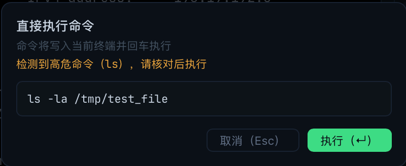
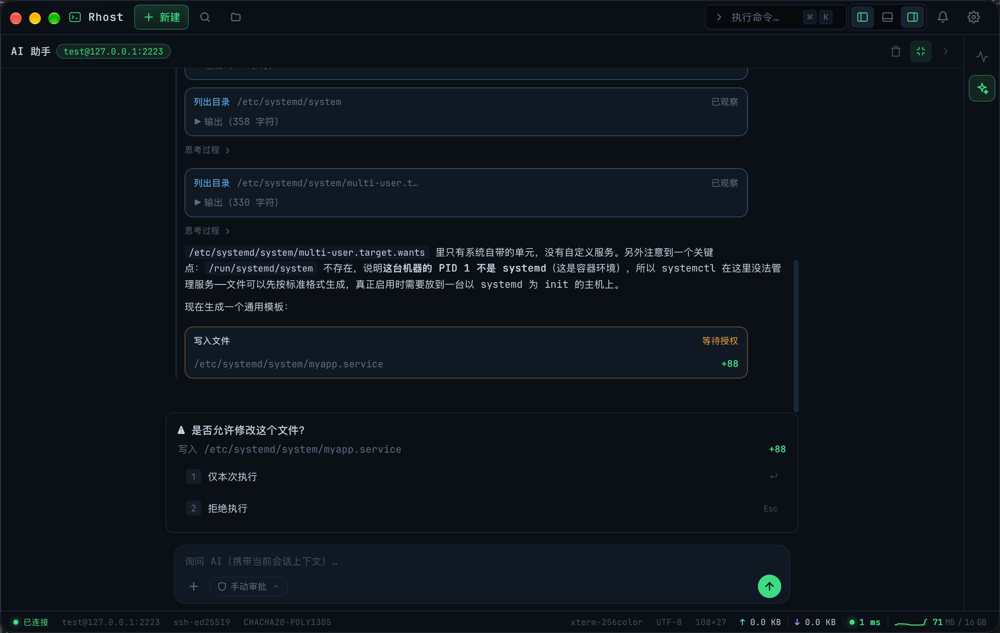
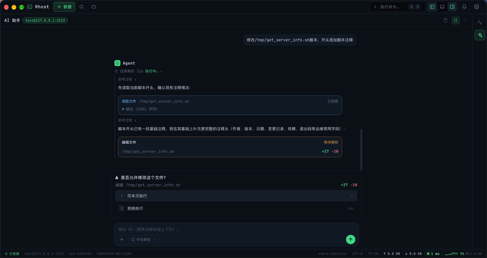

# AI 终端执行与授权

> description: AI 向终端写入命令的两条路径（代码块按钮与工具提案）、授权弹窗、权限档、高危检测与输出回传配置
>
> created: 2026-10-15 11:27:07
>
> updated: 2026-10-15 15:30:00
>
> author: [sjzhao](https://github.com/ShiJieCloud/rhost)

## 1. 两条写入路径

AI 向终端写入命令有两条独立路径，汇入同一 PTY 写入原语，**无静默写入**：

| 路径 | 触发者 | 授权 |
|---|---|---|
| 代码块按钮 | 用户点击「插入终端 / 直接执行」 | 按钮点击本身即意图确认；高危命令按确认档追加弹窗 |
| 工具提案 | 模型调用 `propose_command` / `edit_file` / `write_file` 等 | 经授权弹窗裁决，或按权限档自动放行 |

两条路径均只在**工作台** scope、当前会话**在线**时可用。

## 2. 代码块按钮

助手回复的代码块头部提供「插入终端」与「直接执行」（仅工作台、非流式输出期间可见）：

| 按钮 | 行为 |
|---|---|
| 插入终端 | 把代码原文写入当前活动会话 PTY，**不回车**，可先编辑；多行文本用 bracketed paste 包装，整块进编辑缓冲区等用户回车 |
| 直接执行 | 写入 PTY 并回车执行 |

规则：

- 目标会话 = **点击时的当前活动会话**（不是消息产生时的会话），避免向「当前看不见的终端」写入；
- 无可用会话时提示「无可用会话，无法写入终端」；会话已断开提示「会话已断开，命令未执行」；
- 插入成功提示「已插入终端」。

### 2.1 多行命令

「直接执行」多行命令受设置「**允许多行命令直接执行**」约束（`aiMultilineExec`，默认**关闭**）：

- 关闭时（默认）多行命令「直接执行」被 100% 拦截，提示「多行命令直接执行未开启，可在设置 → AI → 终端执行中开启」；「插入终端」不受影响；
- 开启后多行命令整块提交执行。

### 2.2 直接执行确认档

设置「**直接执行确认**」（`aiExecConfirmMode`）控制弹窗频率：

| 取值 | 行为 |
|---|---|
| 每次确认（`always`） | 每次点击都弹确认窗（完整展示命令原文，`Esc` 取消 / `Enter` 确认） |
| 高危命令确认（`risky`，默认） | 仅在命中高危规则时弹窗并附橙色警示（「检测到高危命令（规则名）」），其余直接执行 |
| 不确认（`never`） | 点击即执行（按钮点击已是意图确认，命令原文就在眼前） |

### 2.3 高危命令检测

两层规则，命中任一层即视为高危：

**内置规则集**（随版本演进维护，不可编辑，无关闭开关）：

| 规则名 | 判定 | 匹配内容 |
|---|---|---|
| 删除文件 | 命令词 | 命令为 `rm` 即命中（`rm -i`、`rm -rf`、`rm --force` 等任意形式） |
| 磁盘格式化/写入 | 正则 | `mkfs.`、`dd ... of=` |
| 系统关机/重启 | 正则 | `shutdown`、`reboot`、`poweroff`、`halt`、`init 0/6` |
| 递归放权 | 正则 | `chmod -R 777` |
| 清空系统文件 | 正则 | 重定向覆盖 `/etc/`、`/dev/sd`、`/dev/nvme`、`/dev/vd` |
| 管道执行远程脚本 | 正则 | `curl \| sh`、`wget \| bash` 等 |
| 强制覆盖远端历史 | 正则 | `git push --force` |

「命令词」判定会先**剥离引号内文本**（`printf "rm"` 这类字符串不误报）、按 `;`/`&`/`|` 切分命令段，再跳过变量赋值与 `sudo`/`env`/`nohup` 等前缀词取命令名；`rmdir` 等仅前缀相同的命令不受影响。

已知边界：命令词不是 `rm` 的间接执行不命中——`git rm`、`docker rm`、`sh -c "rm -rf /"`、`find -exec rm`、`xargs rm`。

**自定义高危关键词**（设置 → AI 助手 → 终端执行 → 「自定义高危关键词」）：一行一条，命令包含即命中；纯子串匹配（**大小写敏感**），支持 `#` 注释行。用于补充你关心的命令片段（如 `docker system prune -a`）。

多行命令**逐行匹配，任一行命中即整段高危**。该检测定位是把确认精力集中在大概率危险操作上，不构成安全边界。

## 3. 模型工具与授权

### 3.1 工具清单

| 工具 | 类型 | 作用 | 执行方式 |
|---|---|---|---|
| `read_file` | 只读 | 读取远端文件内容（单次最多 8KB，超出截断） | **自动执行，无需授权** |
| `list_directory` | 只读 | 列出目录条目（含类型统计） | 自动执行，无需授权 |
| `get_system_info` | 只读 | 系统信息快照（OS、内核、CPU、内存、磁盘、运行时间） | 自动执行，无需授权 |
| `propose_command` | 写 | 提案一条 shell 命令，写入终端 PTY 执行 | 授权路径 |
| `edit_file` | 写 | 用 `new_text` 精确替换 `old_text`（执行前自动备份，单次 ≤ 64KB） | 授权路径 |
| `write_file` | 写 | 全量写入/新建文件（已存在则先备份，单次 ≤ 64KB） | 授权路径 |
| `sftp_upload_file` | 写 | 本机文件上传到远端（≤ 64MB） | 授权路径 |
| `sftp_download_file` | 写 | 远端文件下载到本机（≤ 64MB） | 授权路径 |

只读工具无条件自动执行（不经授权弹窗），因此可快速完成探索类动作。

### 3.2 授权弹窗

写操作提案在提案卡片下方弹出授权弹窗，采用文档流布局**固定在消息区与输入框之间**（不遮挡上方消息，宽度与输入框一致）；内容超出时弹窗内滚动。

| 选项 | 快捷键 | 可用范围 |
|---|---|---|
| 仅本次执行 | `Enter` / `1` | 全部写操作 |
| 本会话允许此命令（后续相同命令自动执行） | `2` | **仅 `propose_command`** |
| 拒绝执行 | `Esc` /（数字键随项数） | 全部写操作 |

- 会话豁免表按**会话级、命令精确匹配**维护，仅内存态，应用重启即失效；
- `edit_file` / `write_file` **无会话级豁免**，每次均需确认；
- 弹窗出现时活动规划面板让位隐藏，裁决完自动恢复。

### 3.3 提案卡片

每条提案以卡片展示状态：

| 状态 | 文案 |
|---|---|
| 等待授权 | 等待授权 |
| 已执行 | 已执行 / 已执行 · 会话允许 |
| 执行失败 | 执行失败 |
| 已拒绝 | 已拒绝 |
| 未裁决即失效 | 已失效 |

卡片内容随工具而异：

| 工具 | 卡片展示 |
|---|---|
| `propose_command` | 命令原文 |
| `edit_file` | `old` → `new` 文本对比 |
| `write_file` | 写入内容预览 |
| `sftp_upload_file` / `sftp_download_file` | 传输进度（在提案卡片内，不进 Dock 传输队列面板） |

文件编辑类工具写入前自动备份，路径命中系统关键文件黑名单时拒绝写入。

## 4. 权限档（代理执行权限）

输入区权限档下拉（盾牌图标）控制模型写操作的自动放行程度。**会话级内存态，不持久化**，切换 scope 自动回落默认档。

| 档位 | 图标语义 | 行为 |
|---|---|---|
| 手动审批（默认） | 盾（全防护） | 所有写操作执行前都需人工确认 |
| 低危自动 | 盾 + 勾 | 低危写操作自动执行，高危仍需确认 |
| 完全访问 | 盾 + 斜杠 | 全部写操作自动执行，不再弹窗 |

「低危/高危」判定复用 §2.3 的高危规则集。只读工具在任何档位下都自动执行。

> 该档位是**降低操作摩擦**的便利开关，不是安全边界：切回默认档可随时收回自动执行。

## 5. 执行结果回传

设置「**执行结果自动回传**」（`aiAutoReturnOutput`，默认**关闭**）：

| 状态 | 行为 |
|---|---|
| 关闭（默认） | 终端输出**零字节**自动发送给模型，保持隐私边界；模型仅凭提案结果知道「执行完了」 |
| 开启 | 提案命令执行完成时，捕获终端输出作为 tool 结果回传，模型可据此自主推进多步执行 |

开启后的捕获规则：订阅终端输出帧，按提示符正则（bash/sh/zsh/fish 常见 PS1）判定命令结束，**超时 30 秒**则截断并附加超时提示；结果中**截断命令回显与提示符行**，只保留真实输出。

> 无论开关状态，终端内容都不会以其它自动形式离开本机；用户仍可随时通过终端右键 → 「添加到 AI 对话」显式发送选中内容。

## 6. 文件传输工具

`sftp_upload_file` / `sftp_download_file` 让 AI 直接完成小文件传输：

| 约束 | 取值 |
|---|---|
| 体积上限 | 64MB（后端在打开目标文件写入前完成校验，超限直接返回明确错误，**不产生残留文件**） |
| 超限提示 | 明确提示超限并引导用户改用 SFTP 面板手动传输 |
| 下载目标路径 | 命中敏感目录黑名单时拒绝；建议填 `~/Downloads/` 下的路径 |
| 上传来源路径 | `local_path` 必须是本机已存在的文件 |

模型侧工具描述已明确禁止用 `scp` / `rsync` / `sftp` 或 `cat | ssh` 管道类命令传输文件，超 64MB 时引导走 SFTP 面板。文件传输进度显示在提案卡片内，**不进入 Dock 传输队列面板**。

## 7. 轮次上限与中止

- 单次用户输入允许的任务循环轮次上限为 6 轮（约 3~4 次只读探索 + 2~3 次命令执行），达上限自动终止续跑；
- 点消息区的**停止生成**立即切断模型循环与 SSE 流，但**不回滚已执行的终端命令与文件修改**，已裁决的提案状态保留；
- 切换会话时取消该会话在飞的只读工具执行任务；
- 会话断开时清理 AI 执行产生的 `/tmp/.ri-*` 临时脚本残留。

## 8. 相关设置一览

| 设置项 | 位置 | 默认值 | 说明 |
|---|---|---|---|
| 允许多行命令直接执行 | AI 助手 → 终端执行 | 关闭 | 关闭时多行命令仅可插入终端人工编辑 |
| 执行结果自动回传 | AI 助手 → 终端执行 | 关闭 | 开启后捕获输出回传模型，实现自主多步执行 |
| 直接执行确认 | AI 助手 → 终端执行 | 高危命令确认 | 每次确认 / 高危命令确认 / 不确认 |
| 自定义高危关键词 | AI 助手 → 终端执行 | 空 | 每行一条，子串匹配，支持 `#` 注释 |

## 9. 相关文档

- [AI 助手使用指南](./ai-assistant.md)：代码块按钮所在的消息渲染；
- [AI 规划模式](./ai-plan-mode.md)：每步执行如何复用本条授权链路；
- [全局设置](../reference/global-settings.md)：AI 模块全部设置项；
- [ai-terminal-exec-design.md](../explanation/design/ai-terminal-exec-design.md)：写入通道、工具协议与捕获机制的设计依据。
